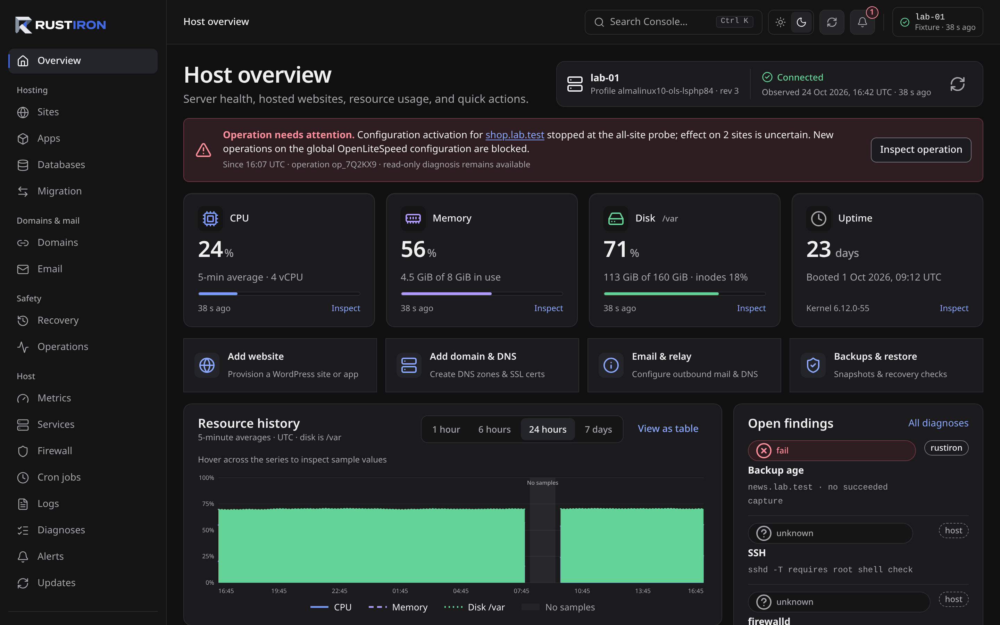
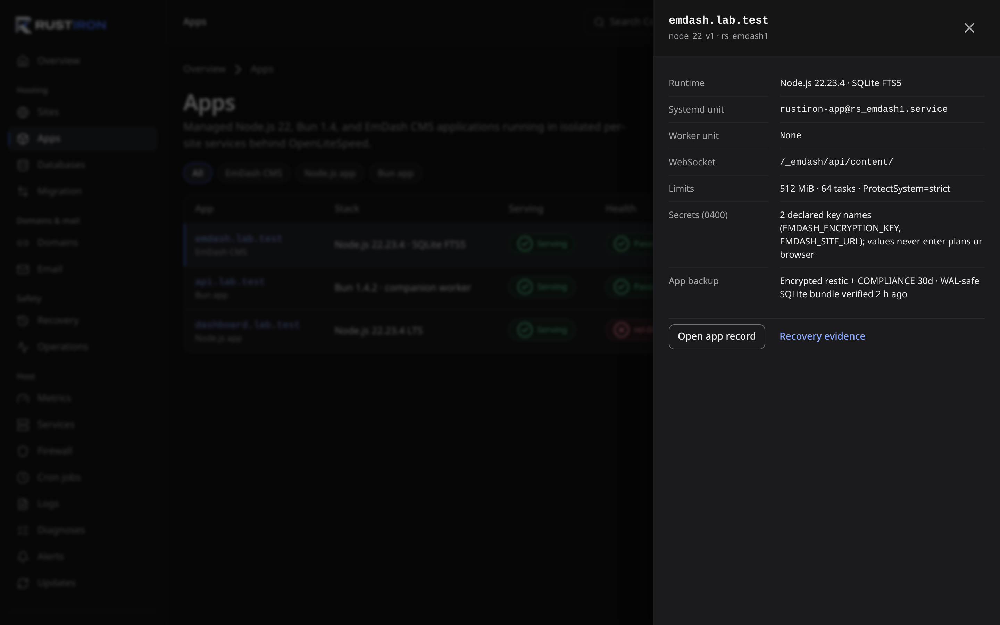
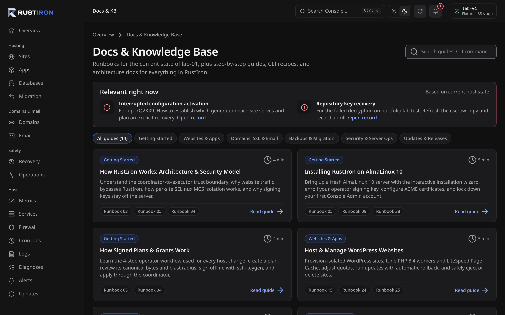
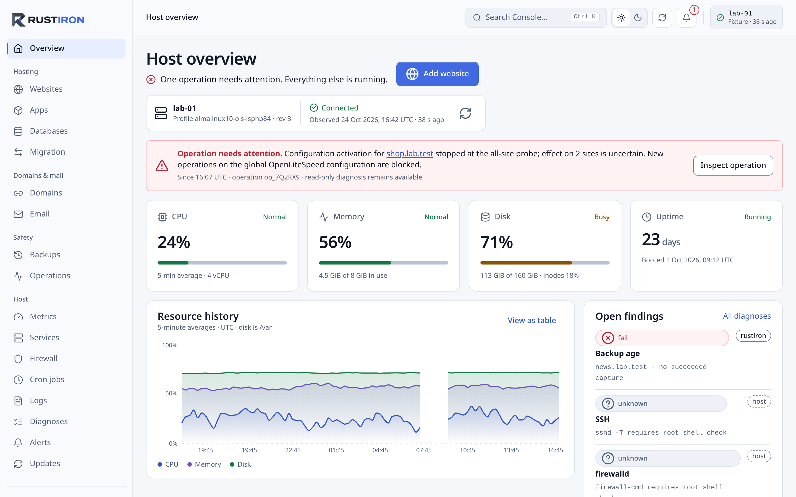
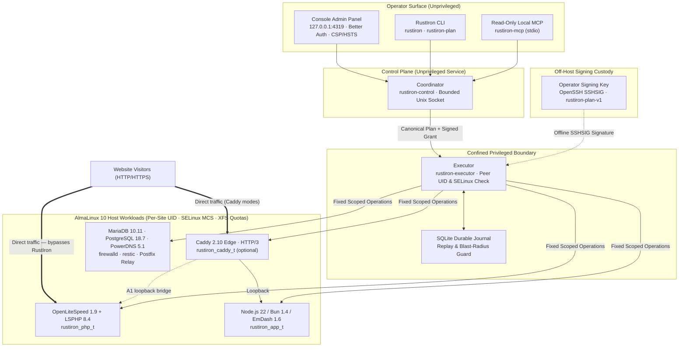

<div align="center">

<picture>
  <source media="(prefers-color-scheme: dark)" srcset="docs/assets/brand/horizontal-dark.svg" />
  <source media="(prefers-color-scheme: light)" srcset="docs/assets/brand/horizontal-light.svg" />
  
</picture>

### Security-first, open-source Linux hosting control plane built with Rust and TypeScript

Orchestrate **WordPress**, full-stack **Node.js 22** / **Bun 1.4** / static SPA apps, and **EmDash CMS** on **AlmaLinux 10**, behind OpenLiteSpeed or a confined **Caddy HTTP/3** edge, with Enforcing SELinux MCS, off-host SSHSIG signed operations, and a hardened Console Admin Panel — without reimplementing web, DNS, database, firewall, or backup engines.

<p>
  <a href="LICENSE"></a>
  
  
  
  
  
  
</p>

<p>
  <a href="#whats-new-in-v011">What's New</a> ·
  <a href="#console-admin-panel">Screenshots</a> ·
  <a href="#architecture">Architecture</a> ·
  <a href="#key-features">Key Features</a> ·
  <a href="#supported-stack">Supported Stack</a> ·
  <a href="#quick-start">Quick Start</a> ·
  <a href="#installation--signed-updates">Install &amp; Updates</a> ·
  <a href="#security-model">Security</a> ·
  <a href="#documentation">Documentation</a>
</p>

</div>

> [!NOTE]
> **Experimental pre-release software.** No production-supported release exists yet. Review [SECURITY.md](SECURITY.md) before exposing any management surface.
> Website HTTP/HTTPS traffic bypasses RustIron completely — if management stops, hosted sites keep serving uninterrupted.

---

## What's New in v0.2

| Area | What changed |
| :--- | :--- |
| **Second factor for Admins** | Admin accounts need a TOTP code from an authenticator app at each sign-in, with ten one-use recovery codes stored encrypted. The setup shows a scannable QR code; a host-shell command resets a lost factor ([Runbook 38](docs/operator/38-CONSOLE-PRODUCTION-DEPLOYMENT.md)). |
| **Sign-in limits** | Failed sign-ins are limited per address, per account, and in total, with clear wait messages and no account lockout. The SSH tunnel is never paused. |
| **Honest live data** | A Console without a live source shows "Unavailable" with the cause and what to check, never sample data. Pages no longer flash sample content while the first observation loads. |
| **Live data path** | The install wizard runs the Console as the coordinator's user and ships a 30-second observation feed, so a fresh host shows its real state. |
| **Safer updates** | The product updater creates new product and state folders that an older install lacks, so hosts installed before v0.1.1 update cleanly, and rolls them back. |
| **Console polish** | Confirmations before deleting accounts and forwarders, mail rules against forwarding loops and hidden mailboxes, field-level form messages, deep links that survive sign-in, and commands shown only for valid wizard input. |
| **Quality** | Whole-project architecture and code-review passes, plus a two-stage QA run (exploratory testing and Bombadil property-based fuzzing) whose 25 findings are all fixed. |

Earlier versions and the full notes for each release are in the [Changelog](CHANGELOG.md).

---

## Console Admin Panel

Built with **React 19**, strict **TypeScript**, **Bun**, **Tailwind CSS v4**, and **Coss UI (`@base-ui/react`)** across **43 built routes**, featuring a Matte Charcoal & Royal Blue default theme, an adaptive light theme, full-screen Better Auth login lockdown, and **290 automated Playwright + axe WCAG 2.2 AA checks**.

<p align="center">
  <picture>
    <source media="(prefers-color-scheme: dark)" srcset="docs/assets/screenshots/console-overview-dark.png" />
    <source media="(prefers-color-scheme: light)" srcset="docs/assets/screenshots/console-overview-light.png" />
    
  </picture>
  <sub><b>Host Overview</b> — Real-time CPU, memory, disk, and uptime metrics, quick hosting actions, interactive resource history chart, and open host findings. Automatically adapts to your GitHub dark or light theme.</sub>
</p>

<table>
  <tr>
    <td width="50%" valign="top">
      
      <p align="center"><sub><b>Apps &amp; Slide-Over Inspector</b> — On-demand detail drawer for Node.js 22, Bun 1.4, and EmDash CMS workloads with zero table layout shift.</sub></p>
    </td>
    <td width="50%" valign="top">
      
      <p align="center"><sub><b>Integrated Docs &amp; Knowledge Base (<code>/help</code>)</b> — 14 step-by-step operational guides, incident-aware context, copyable CLI recipes, and a 38-runbook directory.</sub></p>
    </td>
  </tr>
</table>

<details>
  <summary>Preview Light Theme (Host Overview)</summary>
  <br />
  
</details>

---

## Architecture

RustIron enforces a strict privilege boundary between **unprivileged observation**, **off-host cryptographic authorization**, and **confined privileged execution**.



---

## Key Features

| Area | Capabilities |
| :--- | :--- |
| **Separate-Custody Signed Operations** | Every privileged host mutation requires a canonical JSON plan and an off-host OpenSSH SSHSIG grant (`rustiron-plan-v1`), independently validated by `rustiron-executor` against peer identity, blast-radius budgets, non-replay admission marks, and durable SQLite intent. |
| **Hard Multi-Layer Tenant Isolation** | Per-site Linux accounts, XFS disk quotas, systemd hardening (`IPAddressDeny=any`, `PrivateNetwork=yes` for workers), and Enforcing SELinux MCS types (`rustiron_php_t`, `rustiron_app_t`, `rustiron_mail_relay_t`) confine WordPress pools, Node/Bun/EmDash apps, and mail relays. |
| **Hardened Console Admin Panel** | Full-screen Better Auth login lockdown (`Admin` / `Operator` / `Viewer` RBAC, `HttpOnly; SameSite=Strict; Secure`, rate-limited setup & sign-in), `Host` allowlisting (`421`), zero CORS, and strict CSP/HSTS/`X-Frame-Options: DENY`/`Permissions-Policy`/COOP/CORP headers on every HTML, static, and API route. |
| **Web, App & CMS Lifecycle** | Manage WordPress (with LiteSpeed Page Cache & credential rotation), static/alias/reverse-proxy sites, full-stack Node.js 22 & Bun 1.4 apps (4 topologies, blue/green cutover), EmDash 1.6.0 CMS, PowerDNS 5.1 authoritative zones, ACME TLS certificates, MariaDB, PostgreSQL 18.7 & SQLite databases, and CyberPanel / WXR migrations. |
| **Observability & Recovery** | Live host health diagnoses, version support-matrix tracking, firewall zone controls, systemd timers & WP-Cron visibility, redacted live `systemd-journal` Server Logs, immutable `restic` backups with guided restore probes, and an integrated searchable Knowledge Base (`/help`). |
| **Installer, Bundler & Atomic Updater** | Interactive & non-interactive AlmaLinux 10 install wizard (`packaging/rustiron-install-wizard.py`), deterministic signed release bundler (`scripts/release/bundle_release.py`, namespace `rustiron-release-v1`), and one-command atomic updater with rollback (`packaging/rustiron-updater.py`). |
| **Safe AI / MCP Inspection** | Workstation-local read-only stdio MCP server (`rustiron-mcp`) with recursive control-character and Unicode Bidi sanitization and zero host mutation authority by default. |

---

## Supported Stack

Exact version floors and upstream end-of-life dates are tracked in [`crates/control/support-matrix.json`](crates/control/support-matrix.json) ([Support Matrix](docs/technical/SUPPORT-MATRIX.md)).

| Component | Target Series | Role |
| :--- | :--- | :--- |
| **AlmaLinux** | `10` (`x86_64`, Enforcing SELinux, systemd) | Required host OS |
| **OpenLiteSpeed** | `1.8` / `1.9` | Required HTTP/3 web server & reverse proxy (WebAdmin disabled) |
| **LSPHP** | `8.4` (`8.3` supported alongside) | Required per-site WordPress PHP workers (`rustiron_php_t`) |
| **MariaDB** | `10.11 LTS` | Required loopback-only relational database |
| **firewalld · restic · Certbot** | Host packages | Required network zone, encrypted backups, and ACME TLS |
| **Node.js · Bun** | `22 LTS` / `1.4` | Optional modern JS/TS app runtimes & Console server |
| **Caddy** | `2.10+` | Optional confined HTTP/3 edge ingress for full-stack apps (`rustiron_caddy_t`) |
| **PostgreSQL** | `18.7+` (PGDG) | Optional loopback-only per-app database (`postgresql_18`) |
| **EmDash CMS** | `1.6.0` | Optional Node.js + SQLite WAL/FTS5 CMS (`rustiron_app_t`) |
| **PowerDNS Authoritative** | `5.1` | Optional authoritative DNS zones & TSIG AXFR |
| **Postfix** | Loopback relay | Optional per-site Unix-socket outbound mail relay |

---

## Repository Layout

| Path | Description |
| :--- | :--- |
| [`crates/`](crates/) | Rust workspace (`contracts`, `core`, `control`, `cli`, `journal`, `executor`) — Edition 2024, `unsafe_code = "deny"` |
| [`console/`](console/) | Console Admin Panel — React 19, TypeScript, Bun, Tailwind CSS v4, Coss UI, Better Auth, Playwright + axe e2e suite |
| [`packaging/`](packaging/) | AlmaLinux 10 installer wizard, atomic updater, systemd units, SELinux policy modules, firewall & recipe scripts |
| [`policy/`](policy/) | Core SELinux policy sources (`rustiron_executor`, `rustiron_coordinator`, `rustiron_admin`, workload types) |
| [`scripts/`](scripts/) | Verification gates, pinned native SQLite builder, and signed release bundle tooling |
| [`fuzz/`](fuzz/) | Standalone cargo-fuzz workspace across canonical plans, grants, and DNS zone parsers |
| [`docs/`](docs/) | Public technical specifications, threat model, design tokens, brand assets, and operator runbooks |

---

## Quick Start

### Prerequisites

- **Linux** (`x86_64`) with a C compiler (`gcc` / `clang`) for the pinned SQLite amalgamation
- **Rust `1.99.1`** (automatically picked up via [`rust-toolchain.toml`](rust-toolchain.toml))
- **Python `3.12+`** and **Bun `1.4+`**

### Build & Run Locally

```sh
# 1. Fetch & compile the pinned native SQLite amalgamation
python3 scripts/prepare_sqlite.py --fetch

# 2. Build and test the Rust workspace
cargo test --locked --workspace --all-features

# 3. Verify and launch the Console Admin Panel (loopback-only http://127.0.0.1:4319)
bun install --cwd console
bun run --cwd console verify
bun run --cwd console dev
```

See [Local Development Guide](docs/technical/LOCAL-DEVELOPMENT.md) and [Console Guide](console/README.md) for fixture vs. live host observation modes and browser accessibility checks.

---

## Installation & Signed Updates

For AlmaLinux 10 hosts, RustIron ships an interactive setup wizard, a signed release bundler, and an atomic rollback updater:

```sh
# Interactive AlmaLinux 10 host installation wizard
sudo python3 packaging/rustiron-install-wizard.py

# Pack & sign a unified release bundle (off-host signing workstation, namespace rustiron-release-v1)
python3 scripts/release/bundle_release.py pack   --version 0.2.0   --stage-dir /path/to/staged-release   --out-dir /path/to/dist   --console-dir console   --signing-key ~/.ssh/rustiron_release_ed25519

# Verify and atomically apply a signed bundle on the host (with automatic rollback on failure)
sudo python3 packaging/rustiron-updater.py apply   --bundle rustiron-0.2.0-almalinux10-x86_64.tar.gz   --release-signers /etc/rustiron/release-allowed-signers   --release-signer-id release_signer
```

See [Packaging & Installer Guide](packaging/README.md), [Release Bundler Guide](scripts/release/README.md), [Runbook 16: Product Update](docs/operator/16-PRODUCT-UPDATE.md), and [Runbook 38: Console Production Deployment](docs/operator/38-CONSOLE-PRODUCTION-DEPLOYMENT.md).

---

## Security Model

- **Zero on-host signing keys:** Private plan (`rustiron-plan-v1`) and release (`rustiron-release-v1`) keys never live on managed servers or inside the Console.
- **Fail-closed executor:** `rustiron-executor` refuses unknown ownership, symlinks/hardlinks (`O_NOFOLLOW`), unsigned/replayed plans, oversized requests, and unexplained host drift.
- **Hardened Console by default:** Loopback-only binding (`127.0.0.1:4319`), mandatory first-run setup token & Better Auth login gate, read-only default posture (`405` on write/mail routes unless explicitly enabled), and strict D-090 security headers across every response.
- **Vulnerability reporting:** Never open public issues for security vulnerabilities — follow [SECURITY.md](SECURITY.md).

---

## Documentation

| Guide | Purpose |
| :--- | :--- |
| [Documentation Index](docs/README.md) | Complete map of public technical contracts and operator runbooks |
| [Project Brief](docs/PROJECT_BRIEF.md) | Product intent, scope, and design principles |
| [Architecture](docs/technical/ARCHITECTURE.md) & [Specification](docs/technical/SPEC.md) | Trust boundaries, privilege model, and 23-verb closed operation catalogue |
| [Threat Model](docs/technical/THREAT_MODEL.md) & [Security Policy](SECURITY.md) | Adversary assumptions, isolation guarantees, and disclosure process |
| [Console Admin Panel Guide](console/README.md) & [Backend Boundary](docs/technical/CONSOLE-BACKEND.md) | Console architecture, auth/RBAC, CSP/HSTS headers, and live IPC |
| [Operator Runbooks](docs/operator/README.md) | Step-by-step guides for enrollment, updates, backups, DNS, TLS, and recovery |
| [Design Tokens](docs/DESIGN.md) | Approved Matte Charcoal & Royal Blue visual design system |
| [Changelog](CHANGELOG.md) | Notes for each released version |
| [Contributing](CONTRIBUTING.md) | Coding standards, local verification gates, and pull request workflow |

---

## License

RustIron source code is licensed under the **Apache License 2.0** — see [LICENSE](LICENSE).
External infrastructure services retain their own licenses. RustIron is an independent open-source project and claims no affiliation with the Rust Foundation.
