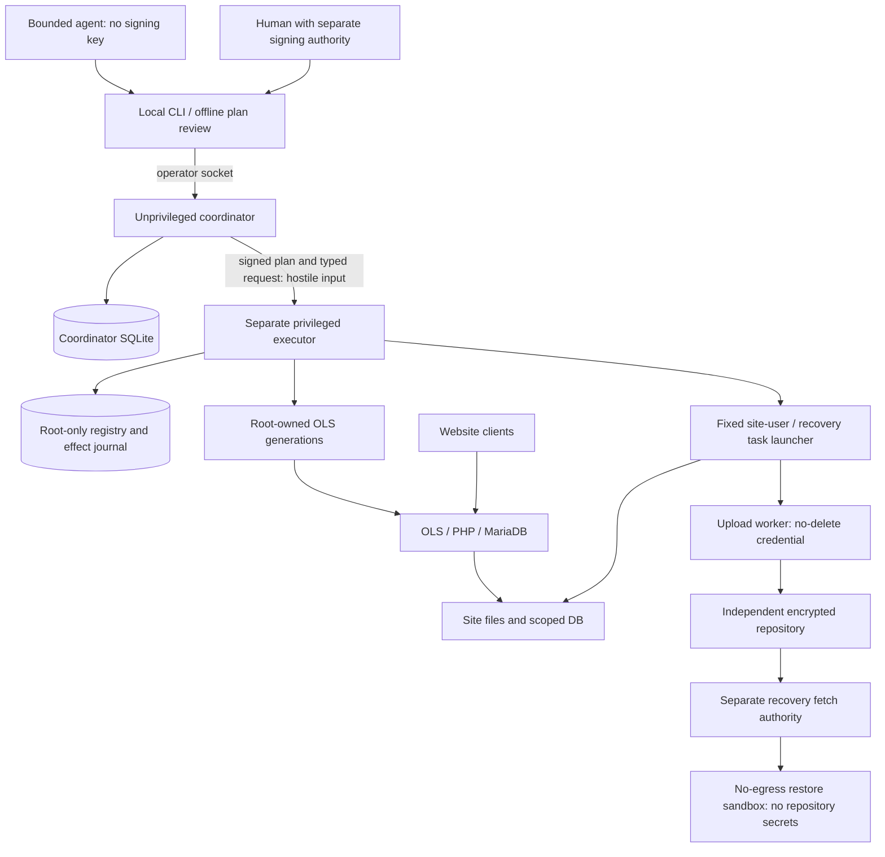

# Rustiron Core architecture

Updated: 2026-11-03.
Accepted mechanism baseline with current implementation limits.
For current experimental implementation and open proof, read [STATE](../STATE.md) and [HANDOFF](../../HANDOFF.md).

This design does not certify completion.
Accepted directions: [DECISIONS.md](../decisions/DECISIONS.md), D-001–D-008.
Behavior: [SPEC.md](SPEC.md).

Adversarial model: [THREAT_MODEL.md](THREAT_MODEL.md).
Delivery: [ROADMAP.md](../planning/ROADMAP.md).
All proposed mechanisms below require tests; this document does not promote G0 prototypes into trusted components.

## Product boundary and decision status

The MVP is the **verified Core proof (G1–G3)**.
Use one trusted operator and one AlmaLinux 10 x86_64 candidate host.
Use one disposable WordPress site and a second adversarial fixture.
Verify the local CLI, signed changes, independent recovery, and escape route.
It is an experimental core, not permission to operate a live site.
G4 pilot, G5 console and G6 extensions follow [Roadmap](../planning/ROADMAP.md#roadmap-to-v10).

The owner approved this delivery boundary and mechanism plan, requesting agent guidance before implementation.
See DECISIONS.
D-001–D-008 remain accepted.
Current lab signing and backend choices are recorded in State.
Production custody, supported package tuple, independent storage, and review remain open.

| Design choice for plan review | Recommended implementation | Reason / fallback |
| --- | --- | --- |
| Local protocol | Versioned, bounded JSON frames over two filesystem Unix sockets | No web stack needed; reject unknown versions/fields at security boundaries |
| Executor lifetime | One synchronous systemd service, process lock plus serialized mutations; no socket-spawned parallel executors | Simpler crash/replay reasoning; revisit concurrency only after measurement |
| Executor storage | Its own root-only SQLite database for registry, grants, intent, outcomes and resource blocks | Atomic admission across authority records; independent of coordinator DB |
| Durability | Coordinator WAL + FULL; executor rollback journal + EXTRA, verified on startup | Explicit synchronization; failure blocks effects; storage still needs reset tests |
| Plan representation | Strict typed JSON, RFC 8785 canonical bytes, SHA-256 with protocol domain separation | Standard canonicalization, no custom cryptography; reviewed library/test vectors required |
| Initial signatures | OpenSSH SSHSIG, fixed `rustiron-plan-v1` namespace, explicit allowlisted signing key/principal | Existing verifier; no agent forwarding or private keys in either service; signer custody remains a human setup choice |
| Host isolation candidate | Per-site UID/GID, DB identity, private paths and PHP process cgroup; enforcing SELinux policy plus tested process/filesystem restrictions | G0 did not prove this; if OLS cannot preserve the boundary, stop before provisioning acceptance and reopen D-002 |
| Recovery composition | Pin restic after integration acceptance; source upload without deletion, separate retention/recovery authority | G0 toolchain evidence exists; backend rights and physical independence need new proof |

These are the approved plan's mechanisms, not proof of their effectiveness.
Record subsequent proof/reopen outcomes in the register.
Do not silently substitute an HTTP API, root shell, container architecture or another OS profile.

## Components and trust boundaries

The coordinator receives operator requests, observes inventory, compiles plans, tracks workflows and exports evidence.
It has no root file-write authority, backup administrator key, signing key or database superuser credential.
Its SQLite contents are assertions the executor must independently verify.

The executor validates local peer identity, schema, signature, resource ownership, budgets and current preconditions.
It alone commits privileged effects from the five-operation catalogue.
A root-owned registry resolves opaque IDs into paths, identities and approved recipes.
It never accepts a shell, tool name, arbitrary environment, SQL, service name, archive path or config text.

Runners execute fixed recipes with site/recovery privileges.
Neither coordinator nor executor evaluates WordPress/plugin PHP as root.
The root launcher establishes the verified sandbox and drops supplementary groups/capabilities before content is accessed.
If the sandbox cannot be established, the task does not run.

Website requests use OLS/PHP/MariaDB directly.
Stopping both Rustiron services must leave established serving processes and their configuration usable.
A management outage may defer changes, backup jobs or certificates.
It must not become a new synchronous dependency for website requests.

## Planned source layout and dependencies

All six Rust crates and the read-only console exist.
Lab deployment and host-test tooling exist under `lab/`.
A supported product installer remains open.
Use the [local development guide](LOCAL-DEVELOPMENT.md) for actual run commands.
The full table describes component responsibilities, not completed hosting capabilities:

| Planned path | Responsibility |
| --- | --- |
| `crates/contracts/` | Versioned messages, strict semantic types, canonicalization and public errors |
| `crates/core/` | Plan compiler, workflow state, ownership observations, coordinator SQLite |
| `crates/cli/` | Human/JSON CLI; offline plan rendering; no private signing-key storage |
| `crates/control/` | Unprivileged socket server, bounded jobs and redacted diagnostics |
| `crates/executor/` | Small synchronous admission, root registry/journal, descriptor-safe writes and fixed launchers |
| `tests/contracts/`, `tests/faults/`, `tests/host/` | Golden contracts, injected failures, disposable Alma10 integration |
| `packaging/`, `fixtures/` | Reviewed service/policy templates and versioned synthetic site fixtures |

Share wire types, not authorization decisions.
The executor owns its own validation and rendering from allowlisted semantic input.
A shared helper must not make coordinator assertions authoritative.
Avoid a generic plugin/action framework.
Keep the first OLS, site and backup adapters concrete.

Prefer standard synchronous Unix I/O initially.
D-009 selects Serde/serde_json, clap, rusqlite, thiserror/tracing and narrow rustix use, with Rust-Toolchain as the local quality gate.
Select exact versions and review SHA-256/canonicalization support in the applicable slice.

Retain the lockfile.
Use OpenSSH's packaged verifier through a fixed, bounded invocation rather than inventing signature verification.
A web frontend/async HTTP runtime, distributed storage and task queue service are unnecessary in this core proof.

The later selected Bun/React/ Astryx stack and conditional Elysia adapter are in TECH-STACK.md.
No dependency is installed by this plan.

## Runtime ownership, configuration and IPC

W003 uses an explicit user-owned mode-0700 test directory, mode-0600 socket and exact same-UID kernel peer checks at both ends, without service installation.
This development policy does not establish the separately enrolled service/ operator identities or root-controlled runtime layout below.
Dated distinct-UID and containment results exist in the S10 audit.
Their scope does not establish complete product IPC or confinement acceptance.

Proposed service identities are `rustiron-control` and root executor.
Actual UIDs are allocated and recorded during reviewed bootstrap, never assumed numeric.
The operator socket is accessible to the approved operator account/group, not site users.

The executor socket is accessible only to the coordinator identity; both endpoints validate kernel peer credentials.
Filesystem permissions alone are insufficient.
Bound connection count, frame size, deadlines, response size and job admission.

Never hold mutation admission while reading an incomplete frame.

| Proposed root | Owner / purpose |
| --- | --- |
| `/etc/rustiron/` | root: host policy, public signer allowlist/revocations, pinned host profile; no tenant edits |
| `/var/lib/rustiron/control/` | coordinator: inventory/cache/plans/workflows/evidence indexes |
| `/var/lib/rustiron/executor/` | root, mode 0700: authoritative registry, journal, generated immutable candidates |
| `/run/rustiron/` | root-created sockets/locks with explicit per-socket access |
| `/srv/rustiron/sites/<opaque-id>/` | root-controlled ancestry; site-owned content, private temp/session and scoped credentials |
| OLS vendor parent and include anchor | explicitly adopted root-controlled ancestry; preserve vendor metadata in manifest |

The site root is a planned new-host layout, not a rename of G0's `/srv/sites/`.
[D-024](../decisions/D-024-product-host-layout.md) (accepted 2026-11-10) keeps `/srv/sites/<account>` for the product profile instead.
Package/service names and OLS include locations come from the pinned profile, never client fields.
Startup verifies root ownership, no writable ancestors or unexpected links, executable hashes/versions and socket identities.

Refuse unknown/conflicting resources.
Bootstrap is a separately reviewed operator procedure on a clean lab host: packages, service accounts, root anchors, signer public keys, host ID and policy installation.
It is not a generic executor verb.

No secrets in plans, argv, JSON, logs or exported evidence.
Credentials are opaque references resolved by a scoped worker.
Private material arrives through verified protected descriptors/files with an explicit lifecycle.
Restored code never receives source/repository/production credentials.
The precise secret delivery mechanism is tested before the corresponding runner is enabled.

## State and durable execution

W004 implements coordinator tables `sites`, `inventory_meta`, `schema_version` with an explicit process lock and WAL/FULL settings.
Imported reports confer no root authority.
See [implemented storage contract](COORDINATOR-INVENTORY.md).
Remaining full-design coordinator tables follow as their slices need them.

Planned coordinator tables: `sites`, `observations`, `plans`, `workflows`, `steps`, `artifact_refs`, `evidence_refs`, `schema_version`.
Root executor tables: `host_identity`, `resource_registry`, `policy_epochs`, `admitted_grants`, `operations`, `step_intents`, `step_outcomes`, `resource_blocks`, `schema_version`.
Do not store signing private keys in either.
Unique grant/operation/step IDs, foreign keys and a single admitted mutation enforce the simple first model.

1. Read a complete bounded request. Authenticate peer, validate schema, host,
   grant, signer/policy epoch, time, operation count and semantic plan digest.
2. Acquire the executor process/admission lock. Re-read trusted state and
   observe actual resources.
Reject stale plans before recording authority use.
3. In one durable executor transaction, consume the grant nonce, bind its
   immutable digest/operation ID, reserve resources and record accepted intent.
On any commit/sync error, do not start effects.
4. For each fixed step, recheck prerequisites and validity. Persist step intent
   and budget consumption before the effect.
Keep external operations outside database transactions.
Verify reality, then durably record the outcome.
5. Mark success only after every required verification and terminal commit.
   Coordinator acknowledgement mirrors executor outcomes.
It cannot create them.

There is no atomic transaction spanning SQLite, OLS, files, MariaDB and restic.
`intent` means an effect might have happened after a crash.
Startup reconciles each interrupted step using its fixed observer.

Known complete effects are recorded.
Proven untouched steps can proceed only within remaining authority.
Ambiguity becomes `needs_attention` with affected resources blocked.

Restarting a daemon is not approval to rerun a command.

Reusing an idempotency key with the same digest returns the existing operation; with a different digest it is a conflict.
A completed operation returns its receipt without repeating effects, even if its original grant is now expired.
A repeated signed grant can retrieve its bound status, never authorize a second operation.

An old DB/VM snapshot can restore consumed nonces under the same host identity.
Before new mutation, recovery rotates host/policy epoch and revokes old grants.
No automatic rollback of admission history.

Use bounded database busy timeouts and check effective PRAGMA values.
Back up SQLite through a consistent backup/quiesced procedure.
Copying a live `.db` alone is insufficient.

Migrations run offline with schema checks and a tested backup/restore route.
Unknown/newer schemas refuse writes.
Never auto-recreate an unreadable executor DB or interpret it as an empty replay ledger.

## Authorization and signer custody

The signed envelope binds canonical plan digest, host identity/epoch, issuer, requesting principal, grant ID, and risk.
The envelope also binds exact resources/verbs, validity, step/reload/time/resource bounds, and permitted compensation.
The executor recomputes semantic intent and rejects mismatches.
Renderer/profile versions and referenced artifact hashes are bound too.
No wildcard “all future changes.”

An offline review helper shows all signed effects and can verify bytes without the coordinator.
Human custody must prevent the requesting agent or either service from accessing the private key or authorizing signatures.
A key on an agent-accessible filesystem, or a forwarded signing agent, fails that requirement.

Use a separately controlled signer workflow.
No hardware purchase is assumed.
Synthetic test keys demonstrate protocol behavior only.

Operator enrollment, revocation, replacement and host recovery are explicit root-admin procedures; the executor cannot enroll its own keys.
Clock uncertainty/backwards jumps deny new mutations until reconciled.
Expiry halts new steps.

An explicitly signed, bounded recovery window can permit predefined compensation, not arbitrary repair.

## Host confinement and OLS lifecycle

First prove the launch/serving model can keep each site's PHP descendants within the selected identity, enforcing MAC domain and resource boundary.
Test files, sockets, process visibility/signals, credentials, shared memory, descendants, network policy and exhaustion.
Separate UID checks do not prove MAC or cgroups.

If OLS's process model defeats per-site containment, reject the candidate.
Do not label the shared `lshttpd.service` cgroup a per-site limit.
Publish RAM/CPU cost instead of weakening isolation.

For configuration, adopt a known clean parent and anchor explicitly, disable WebAdmin, and record every managed/unmanaged dependency.
Render minimal owned includes into immutable root-only generations.
Verify the pinned checker's selection with positive/negative controls, then assess effective vhost mappings, PHP UID/GID and health for **all** sites.
The G0 wrong-host 200 response shows why syntax and HTTP status alone cannot accept a generation.

Stage and sync a new regular file beneath trusted directory descriptors.
Verify type, owner, link count and ancestry.
Replace through the tested same-filesystem atomic pattern and sync parent directories.

Never truncate a caller-selected file, follow tenant symlinks, recursively chown tenant trees or mutate hardlinks.
Keep the previous generation and journal each switch/recycle/probe boundary.
On failed activation, revert only via the predefined authorized compensation, recycle and re-probe all sites.

If reversal cannot be proved, retain the block and report `needs_attention`.
`.htaccess` handling is measured and bounded; site edits never trigger an unbounded global reload loop.
Page caching follows the plugin-driven model in the [page cache design](PAGE-CACHE.md), a proposed design for D-028 item 2.
G0's `KillMode=none` and delayed shutdown behavior must be retested before claiming quiescence.

## Recovery and portability

The site-scoped export recipe first establishes a documented consistent capture window (for the disposable proof, verified quiescence plus scoped DB dump).
It records timing, table/engine limits, hashes and application version.
The site/backup worker handles untrusted content without root tree traversal and uploads encrypted artifacts with backend-enforced no-delete rights.
A failure to capture consistency is recorded, not promoted to an application-consistent backup.
Retention/pruning is outside the source executor's authority.

`restore_probe` restores a known snapshot into a new bounded local sandbox for automated hostile-content testing.
A separate fetch phase uses recovery rights, then removes credentials/mounts before untrusted content is parsed/executed.
No network egress, mail, host mounts or production secrets.

Throwaway identities, DB, resource limits and cleanup receipts.
Local success cannot establish physical independence.
S09 separately restores off-host data on an independent clean host, using documented manual tooling and recovered keys **without Rustiron**.

Imported evidence records who attested, which host/repository and which artifacts were tested.
Self-reported coordinator JSON cannot prove independent recovery.

Export seven separate receipt fields from the brief with `pass|fail|unknown|not_run`, observed scope, time and supporting artifact hashes.
Manual recovery includes portable configuration, site/DB exports, version manifest, key-recovery procedure, ownership and eject instructions.
Do not export plaintext secrets or trust a hash chain as protection from a compromised root host.

## Observability, failure handling and documentation

Use bounded redacted structured events with operation/step/site IDs, monotonic duration and wall timestamps.
Distinguish observer failure, failed effect, failed compensation and uncertain state.
Record disk pressure, DB/journal health, service/identity drift and backup evidence age.

Read-only observations never repair state.
Export machine codes and human recovery guidance.
A site name or plugin log is data, never an instruction.

Root-host compromise can alter local evidence.
Independent exports provide another trust domain.

The Project Brief defines product intent.
D-018 and AUTONOMY define current participation.
The roadmap is the only queue.

`docs/STATE.md` records dated implementation; `DECISIONS.md` and ADRs govern locks; this page and `SPEC.md` define the proposed system.
`VALIDATION.md` separates observed evidence from future acceptance.
Root `AGENTS.md` contains verified project boundaries only.

Use the existing local development and manual recovery guides for commands.
Do not copy task history or create duplicate agent rules.

## Integration and authority boundaries

The product orchestrates OLS/LSPHP, MariaDB, restic, systemd, PowerDNS, and firewalld.
Node.js and Bun app deployment/management are required product capabilities.
The [roadmap](../planning/ROADMAP.md) owns each integration task and acceptance condition.
The [stack](TECH-STACK.md) distinguishes implemented and planned components.

PowerDNS zone operations and firewalld changes need explicit ownership, scoped authority, current preconditions, interruption, and recovery contracts.
Neither adapter receives generic root commands or unrestricted service credentials from browser sessions.
App builds and package scripts run outside root and outside management secrets.
A mature app-platform adapter is permitted only with tested lifecycle and recovery boundaries.
Service reuse does not prove cross-site isolation or source compatibility.

Production key custody, independent recovery, critical security review, publication, and cutover retain the [autonomy checkpoints](../AUTONOMY.md).
A different human guide follower is optional under D-018.
The technical recovery requirements remain unchanged.

## Primary mechanism references

These references informed recommended mechanisms.
They do not prove our host implementation.
OpenSSH documents namespaced signatures, allowlisted principals and revocation inputs in [ssh-keygen](https://man.openbsd.org/ssh-keygen).
Canonical JSON uses [RFC 8785](https://www.rfc-editor.org/rfc/rfc8785.html).
SQLite documents synchronization settings and filesystem assumptions in [PRAGMA synchronous](https://www.sqlite.org/pragma.html#pragma_synchronous) and [atomic commit](https://www.sqlite.org/atomiccommit.html).
Kernel, VFS and hardware behavior remain part of the target-host fault tests.

<!-- Compatibility anchors for pre-refactor references. -->

